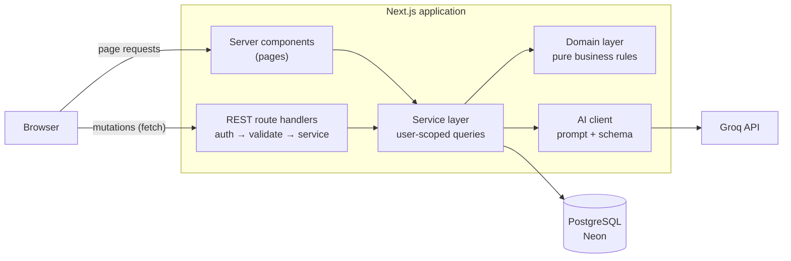
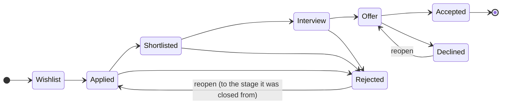
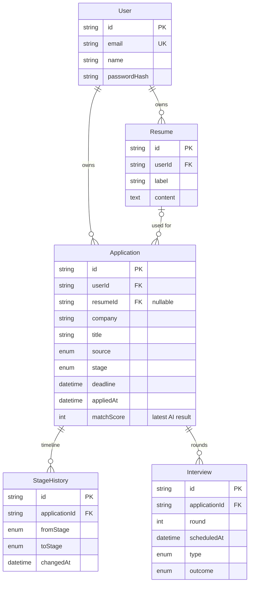

<div align="center">

# KormoBihin

**A job-application tracker for fresh graduates in Bangladesh, with AI-powered CV-to-job matching.**

<sub><i>KormoBihin</i> (কর্মহীন) means "unemployed" in Bangla.</sub>

<br />


[Overview](#overview) · [Features](#features) · [Architecture](#architecture) · [API](#api-reference) · [AI matching](#ai-cv-matching) · [Getting started](#getting-started)

</div>

---

## Table of contents

- [Overview](#overview)
- [Features](#features)
- [Tech stack](#tech-stack)
- [Architecture](#architecture)
- [Application workflow](#application-workflow)
- [Data model](#data-model)
- [API reference](#api-reference)
- [AI CV matching](#ai-cv-matching)
- [Security](#security)
- [Getting started](#getting-started)
- [Project structure](#project-structure)
- [Known limitations](#known-limitations)

---

## Overview

### The problem

Fresh graduates in Bangladesh often apply to dozens of positions at once across Bdjobs, LinkedIn, Facebook job groups, company career sites and referrals. Most of them keep track in a notebook or a spreadsheet, if at all. As a result, applications are forgotten, deadlines are missed, follow-ups never happen, and candidates can't see which gaps in their CV keep costing them interviews.

### The solution

KormoBihin is a personal application tracker built for the Bangladeshi job market:

| | |
| --- | --- |
| **One pipeline** | Every application moves through a validated hiring workflow, and each change is recorded in a timeline. |
| **Proactive flags** | Applications with no reply after 21 days and deadlines within 3 days are flagged automatically. |
| **Search insights** | The dashboard shows which job sources actually reply, so effort goes where it pays off. |
| **AI CV matching** | An AI comparison of a CV against a job description returns a score, the missing skills and concrete tips for improving the CV. |

---

## Features

### Application tracking
- Full create, read, update and delete for applications. Each one holds the company, title, source, job link, description, location, salary range (BDT), deadline and notes.
- A **validated stage workflow** that the server enforces, so stages can't be skipped. See [Application workflow](#application-workflow).
- A **complete timeline** of every stage change, with optional notes.
- **Reopening** rejected or declined applications, which returns them to the stage they were closed from.
- **Interview rounds** with a date, a type (phone, written, viva, technical, HR) and an outcome.
- **Two views:** a filterable, sortable, searchable list and a board with one column per stage.

### Dashboard and insights
- A **pipeline chart** of applications by stage.
- **Up next:** upcoming interviews, approaching deadlines and due follow-ups, sorted by urgency.
- **Reply rate by source**, with the best-performing source highlighted (needs at least 2 applications).
- **Automatic flags:** *No response* (21 days at Applied), *Deadline soon* (3 days or less) and *Deadline passed*.

### CV management and AI
- Several CV versions per user, added by pasting text or **uploading a PDF** (the text is extracted on the server).
- An **AI match** for any application: a 0–100 score, a Strong/Moderate/Weak label, matched skills, missing skills and three improvement tips.

### Experience
- A responsive design with a dedicated phone layout (bottom tab bar, 40 px touch targets).
- Loading skeletons, inline field-level validation, toast feedback and confirmation dialogs for destructive actions.
- Respects the user's *reduced motion* preference.

---

## Tech stack

| Layer | Technology |
| --- | --- |
| **Framework** | Next.js 16 (App Router), React 19, TypeScript |
| **Database** | PostgreSQL (Neon), Prisma 7 ORM with the `pg` driver adapter |
| **Authentication** | Stateless JWT (`jose`, HS256) in an httpOnly cookie, `bcryptjs` password hashing |
| **Validation** | Zod, with schemas shared between client and server |
| **AI** | Groq Chat Completions API (`openai/gpt-oss-120b`), JSON mode |
| **UI** | Tailwind CSS 4, shadcn/ui (Radix primitives), Lucide icons, Sonner |
| **File processing** | `unpdf` for server-side PDF text extraction |

---

## Architecture



- **Reads** happen in server components, which call the service layer directly. There is no internal HTTP hop.
- **Writes** go through the REST API from client components, then the page is refreshed.

### Key design decisions

| Decision | Rationale |
| --- | --- |
| **Business rules as pure functions** (`src/lib/domain`) | Stage transitions, flags and statistics have no I/O, so they are easy to reason about and change. |
| **Ownership enforced in the service layer** | Every query is scoped to the authenticated user's id. A request for another user's record returns **404**, not 403, so the API never confirms that the record exists. |
| **Transactional stage changes with optimistic locking** | The stage update and its timeline entry are written atomically. Two concurrent moves give one success and one **409 Conflict**, never a corrupted history. |
| **Flags and statistics computed on read** | No stored state and no scheduled jobs, so they are always current. |
| **One response envelope** | Every endpoint returns `{ success, data }` or `{ success, error, fieldErrors }`. Errors are mapped centrally and stack traces never reach the client. |

```jsonc
// Success
{ "success": true, "data": { ... } }

// Failure (for example, a validation error)
{ "success": false, "error": "Please check the highlighted fields.", "fieldErrors": { "company": ["Company is required"] } }
```

| Status | Meaning |
| --- | --- |
| `400` | Validation failed |
| `401` | Not authenticated |
| `404` | Not found, or not owned by the user |
| `409` | Conflict (duplicate email, concurrent edit) |
| `422` | Business rule violated (for example, an invalid stage transition) |
| `429` | Rate limit exceeded, or the AI provider is busy |
| `502` / `503` / `504` | The AI provider returned an invalid response, is unavailable, or timed out |

---

## Application workflow

The server enforces these transitions. Any other move is rejected with `422`.



- Moving to **Applied** records the application date if it isn't set yet.
- **Accepted** is final. **Rejected** and **Declined** can be reopened, and the reopening is recorded in the timeline.

---

## Data model



- Deleting a user cascades to all of their data.
- Deleting a CV keeps the applications that used it and clears the reference (`SET NULL`).
- Indexes on `(userId, stage)` and `(userId, createdAt)` support the filtered list views.

---

## API reference

All endpoints except `register` and `login` require an authenticated session cookie.

### Authentication

| Method | Endpoint | Description |
| --- | --- | --- |
| `POST` | `/api/auth/register` | Create an account and start a session |
| `POST` | `/api/auth/login` | Authenticate and set the session cookie |
| `POST` | `/api/auth/logout` | End the session |
| `GET` | `/api/auth/me` | Return the current user |

### Applications

| Method | Endpoint | Description |
| --- | --- | --- |
| `GET` | `/api/applications` | List applications. Query: `stage`, `source`, `q`, `sort`, `closed=hide` |
| `POST` | `/api/applications` | Create an application |
| `GET` · `PATCH` · `DELETE` | `/api/applications/:id` | Get, update or delete an application |
| `POST` | `/api/applications/:id/stage` | Move to the next stage (validated transition) |
| `POST` | `/api/applications/:id/reopen` | Reopen a rejected or declined application |
| `POST` | `/api/applications/:id/match` | Run the AI CV match and save the result |

### Interviews

| Method | Endpoint | Description |
| --- | --- | --- |
| `GET` · `POST` | `/api/applications/:id/interviews` | List or add interview rounds |
| `PATCH` · `DELETE` | `/api/applications/:id/interviews/:interviewId` | Update or delete a round |

### CVs and statistics

| Method | Endpoint | Description |
| --- | --- | --- |
| `GET` · `POST` | `/api/resumes` | List or create CVs |
| `GET` · `PATCH` · `DELETE` | `/api/resumes/:id` | Get, update or delete a CV |
| `POST` | `/api/resumes/parse-pdf` | Extract text from a PDF (max 4 MB) |
| `GET` | `/api/stats` | Dashboard statistics |

---

## AI CV matching

`POST /api/applications/:id/match` sends the application's job description and its linked CV to Groq and stores the validated result on the application.

**Example result**

```json
{
  "score": 82,
  "label": "Strong",
  "matchedSkills": ["React", "TypeScript", "REST APIs", "Git"],
  "missingSkills": ["Jest", "Next.js"],
  "tips": [
    "Add a project that uses Jest or React Testing Library.",
    "Mention any Next.js work, even from coursework.",
    "Quantify the impact of your internship project."
  ]
}
```

| Concern | Approach |
| --- | --- |
| **Consistency** | Temperature `0`, JSON response mode, inputs capped at 6,000 characters each |
| **Reliability** | The response is validated with Zod; skills are de-duplicated and lists are capped. Invalid output is rejected and never saved. |
| **Integrity** | The Strong/Moderate/Weak label is calculated from the score in code (75 and above is Strong, 50 and above is Moderate), not taken from the model |
| **Fairness** | Only checkable requirements are judged (skills, tools, qualifications, experience, education). Soft skills are never scored. The prompt infers fundamentals from frameworks (React implies HTML, CSS and JavaScript). |
| **Failure handling** | No fabricated fallback score. Timeouts (20 s), rate limits and invalid responses map to clear errors with a retry, and the last saved result stays visible. |
| **Abuse protection** | 10 match requests per minute per user |

> Scores near a label boundary can vary by about ±10 between runs. The result is guidance for the candidate, not a hiring decision.

---

## Security

- **Passwords:** hashed with bcrypt (cost factor 10). The login error is generic, so it never reveals whether an account exists.
- **Sessions:** a 7-day JWT in an `httpOnly`, `SameSite=Lax` cookie, which is `Secure` in production. Lax blocks cross-site POST requests (CSRF).
- **Authorization:** every route checks the session, and every query is scoped to the authenticated user.
- **Input validation:** request bodies, query parameters and route ids are all validated with Zod.
- **Rate limiting:** 5 logins and 5 registrations per minute per IP, and 10 AI requests per minute per user.
- **File uploads:** a size limit plus a check of the PDF file signature, not just the file extension.
- **Open-redirect protection:** redirects after login only go to paths inside the app.
- **Configuration:** environment variables are validated at startup, and secrets are never committed.

---

## Getting started

### Prerequisites

- Node.js 20 or newer (developed on Node 24)
- A PostgreSQL database (a free [Neon](https://neon.tech) project works)
- A [Groq API key](https://console.groq.com/keys)

### Installation

```bash
git clone https://github.com/mdsamiulhaq03/kormobihin.git
cd kormobihin
npm install                # installs dependencies and generates the Prisma client
cp .env.example .env       # then fill in the variables below
npx prisma migrate deploy  # applies the database schema
npm run dev                # http://localhost:3000
```

### Environment variables

| Variable | Required | Description |
| --- | :---: | --- |
| `DATABASE_URL` | ✅ | Pooled PostgreSQL connection string (used by the app) |
| `DIRECT_URL` | ✅ | Direct connection string (used by Prisma migrations) |
| `JWT_SECRET` | ✅ | At least 32 random characters for signing session tokens |
| `GROQ_API_KEY` | ✅ | Groq API key |
| `GROQ_MODEL` | | Model id. Defaults to `openai/gpt-oss-120b` |

### Available scripts

| Script | Description |
| --- | --- |
| `npm run dev` | Start the development server |
| `npm run build` | Generate the Prisma client and build for production |
| `npm start` | Serve the production build |
| `npm run lint` | Lint with ESLint |
| `npm run typecheck` | Type-check with TypeScript |
| `npm run db:migrate` | Create and apply a development migration |
| `npm run db:studio` | Open Prisma Studio |

---

## Project structure

```
kormobihin/
├── prisma/
│   ├── schema.prisma        # Data model
│   └── migrations/          # SQL migrations
├── src/
│   ├── app/
│   │   ├── (auth)/          # Login and registration
│   │   ├── (app)/           # Dashboard, applications, CVs (protected)
│   │   ├── api/             # REST route handlers
│   │   └── page.tsx         # Landing page
│   ├── components/          # UI components, grouped by feature
│   ├── hooks/               # Client hooks
│   ├── lib/
│   │   ├── ai/              # Groq client, prompt, response schema
│   │   ├── auth/            # Password hashing, JWT, sessions
│   │   ├── domain/          # Pure business rules
│   │   ├── services/        # User-scoped data access
│   │   └── validators/      # Shared Zod schemas
│   └── proxy.ts             # Route protection
└── public/                  # Static assets
```

---

## Known limitations

| Area | Limitation |
| --- | --- |
| **Rate limiting** | Counters are kept in memory per server instance. On serverless hosting they aren't shared and they reset on cold start. A shared store such as Redis would make them global. |
| **PDF upload** | Only text-based PDFs are supported. Scanned documents would need OCR. |
| **Language** | The interface is English only, and the AI matching hasn't been tested with Bangla CVs. |
| **Cold starts** | The free-tier Neon database pauses when idle, so the first request after inactivity can take a few seconds. |
| **Reminders** | Flags appear in the app only. There are no email or push notifications. |

---

<div align="center">

Built by [@mdsamiulhaq03](https://github.com/mdsamiulhaq03)

</div>
